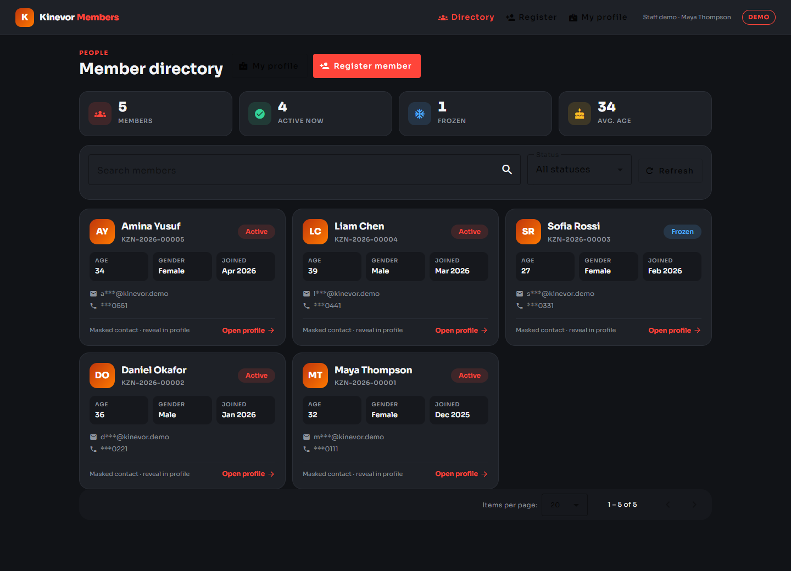
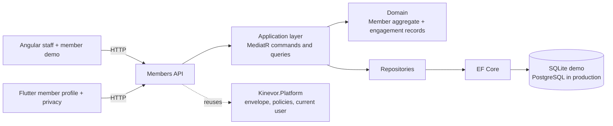
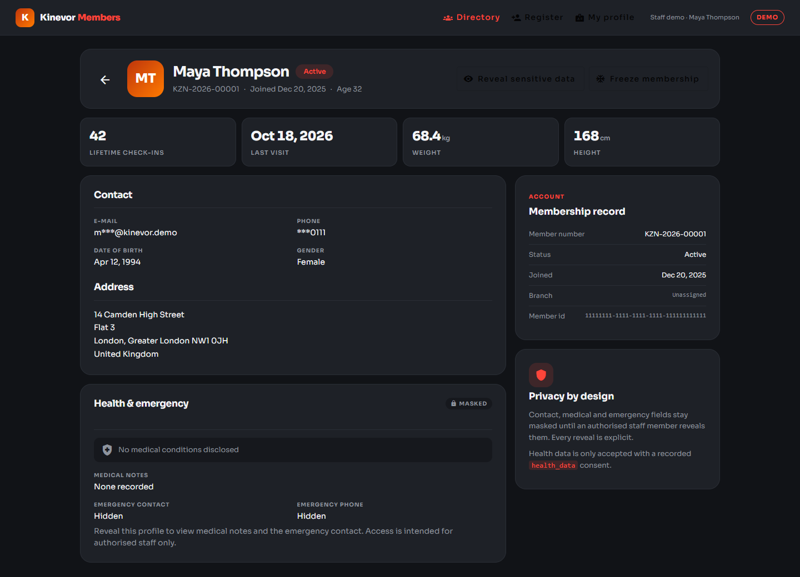
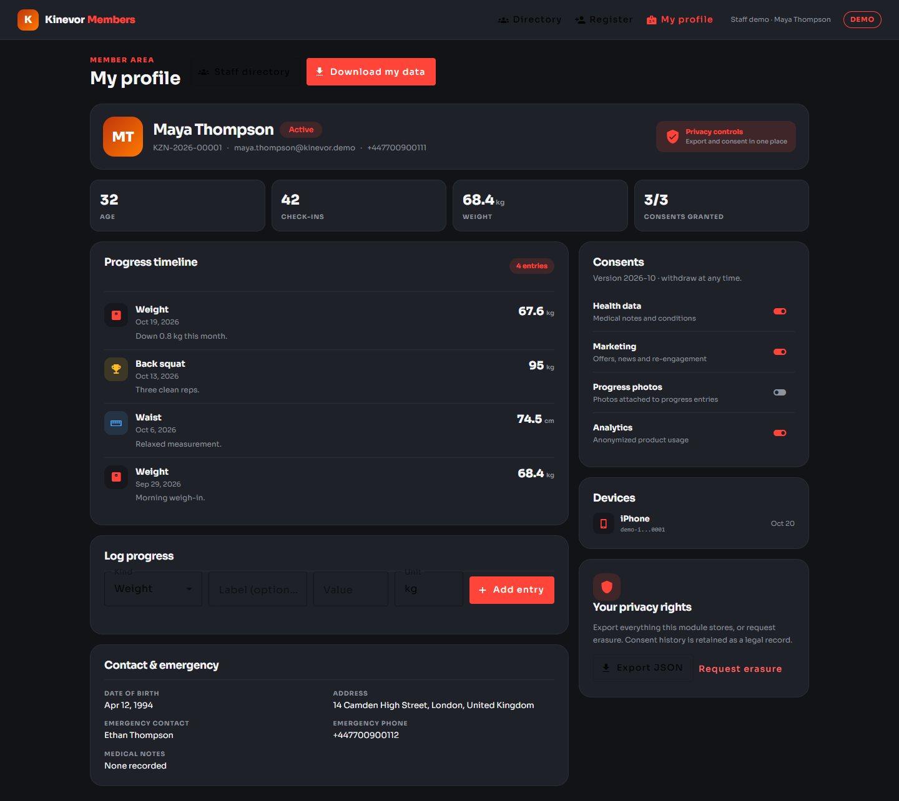
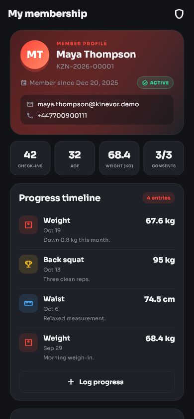
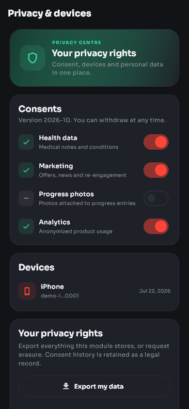
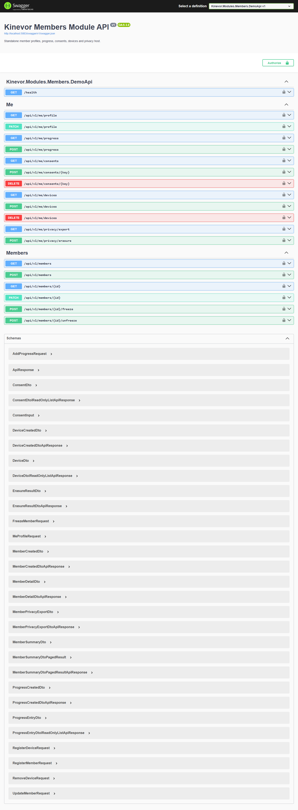

# Kinevor Members

Member management vertical slice for the Kinevor gym platform: a .NET 9 API,
a standalone Angular library and demo, and a Flutter package with a runnable
example. Every layer can be consumed independently, and the demo runs locally
without the original Kinevor monorepo.

[](https://github.com/SoftwareDeveloper98/kinevor-members/actions/workflows/ci.yml)
[](https://github.com/SoftwareDeveloper98/kinevor-members/pkgs/nuget/Kinevor.Modules.Members)
[](https://github.com/SoftwareDeveloper98/kinevor-members/pkgs/npm/kinevor-members-web)
[](https://flutter.dev)
[](LICENSE)



## Why this module

Members is the record of who belongs to the gym: identity, contact details,
health context, progress, consents and the data-rights workflow. This repository
packages that slice for staff and member-facing applications.

- Staff search, filter, register, inspect, freeze and unfreeze members.
- Sensitive contact, medical and emergency fields stay masked until explicitly
  revealed by authorised staff.
- Members manage their own profile, progress entries, consents, devices, export
  and erasure.
- Health data requires a recorded `health_data` consent at registration.
- Angular and Flutter clients share the same API contract.

## Architecture



The backend is organized into domain/application/API folders within a single project, with a separate EF Core persistence project. It depends
on the published `Kinevor.Platform.*` packages for the response envelope,
authorization policies and current-user abstractions. The Angular and Flutter
clients are thin presentation layers over a typed gateway/repository.

## Features

- Searchable, paged member directory with lifecycle status filters.
- Registration with address, emergency contact, optional health context and
  consent capture.
- Profile updates, freeze with reason and expiry, and unfreeze.
- Explicit sensitive-field reveal for staff; masked summaries by default.
- Self-service progress timeline with weight, measurement, personal-record and
  photo entries.
- Consent grants and withdrawals for health data, marketing, progress photos and
  analytics.
- Push-device projections with masked tokens.
- Module-owned JSON export and erasure that anonymizes the profile, purges
  progress and devices, and retains consent history as a legal record.
- Angular: standalone components, Material UI, typed gateway/facades, injectable
  providers, routes and Vitest tests.
- Flutter: injectable repository/client, profile and privacy screens, progress
  composer, golden tests and a runnable example.
- SQLite demo with five seeded members, progress, consents, a device and Swagger.

## Endpoints

| Method | Route | Policy | Used by |
| --- | --- | --- | --- |
| `GET` | `/api/v1/members?search=&status=&page=&pageSize=` | `StaffOrAdmin` | Staff directory |
| `GET` | `/api/v1/members/{id}?reveal=` | `StaffOrAdmin` | Staff profile |
| `POST` | `/api/v1/members` | `StaffOrAdmin` | Registration |
| `PATCH` | `/api/v1/members/{id}` | `StaffOrAdmin` | Profile update |
| `POST` | `/api/v1/members/{id}/freeze` | `StaffOrAdmin` | Freeze |
| `POST` | `/api/v1/members/{id}/unfreeze` | `StaffOrAdmin` | Unfreeze |
| `GET` | `/api/v1/me/profile` | `MemberOrAbove` | Member profile |
| `PATCH` | `/api/v1/me/profile` | `MemberOrAbove` | Member profile update |
| `GET` | `/api/v1/me/progress` | `MemberOrAbove` | Progress timeline |
| `POST` | `/api/v1/me/progress` | `MemberOrAbove` | Log progress |
| `GET` | `/api/v1/me/consents` | `MemberOrAbove` | Consent centre |
| `POST` | `/api/v1/me/consents/{key}` | `MemberOrAbove` | Grant consent |
| `DELETE` | `/api/v1/me/consents/{key}` | `MemberOrAbove` | Withdraw consent |
| `GET` | `/api/v1/me/devices` | `MemberOrAbove` | Device list |
| `POST` | `/api/v1/me/devices` | `MemberOrAbove` | Register device |
| `DELETE` | `/api/v1/me/devices` | `MemberOrAbove` | Remove device |
| `GET` | `/api/v1/me/privacy/export` | `MemberOrAbove` | Data export |
| `POST` | `/api/v1/me/privacy/erasure` | `MemberOrAbove` | Erasure |
| `GET` | `/health` | anonymous | Demo health check |
| `GET` | `/swagger` | development only | API explorer |

All responses use the platform `ApiResponse<T>` envelope. Staff summaries mask
e-mail and phone. Profile detail masks e-mail, phone, medical notes and emergency
contacts until `reveal=true` is requested by an authorised staff user.

## Screenshots

### Web

| Directory | Member detail |
| --- | --- |
|  |  |

| Member self-service |
| --- |
|  |

### Flutter

| Profile | Privacy and devices |
| --- | --- |
|  |  |

### API



## Quick start

### Prerequisites

- .NET SDK 10 (the solution uses `.slnx`) and the ASP.NET Core 9 runtime.
- Node.js 22+ and npm 10+.
- Flutter 3.35+ (the repository is verified with Flutter 3.47.7).

### 1. Build the platform packages

The backend restores `Kinevor.Platform.*` from the sibling platform repository's
local package feed. Clone it next to this repository and pack it once:

```powershell
git clone https://github.com/SoftwareDeveloper98/kinevor-platform.git ..\kinevor-platform
dotnet pack ..\kinevor-platform\backend\Kinevor.Platform.slnx -c Release `
  -o ..\kinevor-platform\backend\artifacts\packages
```

If the platform packages are published to GitHub Packages, configure that source
instead and skip the local pack step.

### 2. Run the API

```powershell
dotnet restore backend\Kinevor.Modules.Members.slnx
dotnet run --project backend\samples\Kinevor.Modules.Members.DemoApi
```

The API listens on `http://localhost:5083`. Open
`http://localhost:5083/swagger` for the explorer. The demo creates a SQLite
database and seeds five members on first run. Maya Thompson is the primary
self-service member:

| Member | Number | Status | Check-ins |
| --- | --- | --- | --- |
| Maya Thompson | `KZN-2026-00001` | Active | 42 |
| Daniel Okafor | `KZN-2026-00002` | Active | 18 |
| Sofia Rossi | `KZN-2026-00003` | Frozen | 7 |
| Liam Chen | `KZN-2026-00004` | Active | 63 |
| Amina Yusuf | `KZN-2026-00005` | Active | 25 |

The demo trusts development-only headers:

| Header | Purpose | Example |
| --- | --- | --- |
| `X-Demo-Role` | Selects the authenticated role | `Staff`, `Member`, `Admin` |
| `X-Demo-Email` | Sets the current user e-mail | `staff.demo@kinevor.local` |
| `X-Demo-Member` | Binds a member identity | `11111111-1111-1111-1111-111111111111` |
| `X-Branch-Id` | Selects the branch context | branch GUID |

These headers are a demo adapter only. Never enable them in production.

### 3. Run the web demo

For local development, build the platform web package once:

```powershell
cd ..\kinevor-platform\web
npm install
npm run build
cd ..\..\kinevor-members\web
npm run install:local
npm start
```

`npm run install:local` temporarily points the workspace at the local platform
build, installs dependencies, restores `package.json`, and removes the generated
lockfile. When the package is published to GitHub Packages, authenticate the
scope in `.npmrc` and use the normal path instead:

```powershell
cd web
npm install
npm start
```

The web demo runs at `http://localhost:4202` with routes:

- `/members` - searchable staff directory
- `/members/new` - registration form with consent capture
- `/members/:id` - masked profile, reveal, freeze and unfreeze
- `/me` - member profile, progress, consents, devices and privacy

The demo interceptor sends the `Staff` role and Maya's member id. A real host
supplies its own authentication and platform configuration.

### 4. Run the Flutter example

```powershell
cd mobile\packages\kinevor_members
flutter pub get
cd example
flutter run -d chrome
```

The example targets `http://localhost:5083/api/v1` by default. Override it for an
emulator or remote host:

```powershell
flutter run -d chrome `
  --dart-define=KINEVOR_API_BASE_URL=http://localhost:5083/api/v1
```

On an Android emulator use `http://10.0.2.2:5083/api/v1`. The demo API allows the
Angular origin `http://localhost:4202`; add your host origin before running the
Flutter web example from another port.

### 5. Refresh screenshots

With both servers running:

```powershell
cd web
npm run capture:screenshots
```

The Playwright script writes the web and API images to `docs/screenshots`.
Regenerate the Flutter goldens with:

```powershell
cd mobile\packages\kinevor_members
flutter test --update-goldens test\members_golden_test.dart
```

## Testing

| Area | Command |
| --- | --- |
| Backend | `dotnet test backend\Kinevor.Modules.Members.slnx -c Release` |
| Web unit tests | `cd web; npm test` |
| Web builds | `cd web; npm run build:all` |
| Flutter analysis | `cd mobile\packages\kinevor_members; flutter analyze` |
| Flutter tests | `cd mobile\packages\kinevor_members; flutter test` |

The backend suite covers domain invariants, registration consent rules,
freeze/unfreeze, masking, progress, devices and privacy behavior against the demo
host. The web suite covers the HTTP gateway and both facades with Vitest. The
Flutter suite covers the client, profile/privacy screens and golden images.

## Packages

| Ecosystem | Package | Contents |
| --- | --- | --- |
| NuGet | `Kinevor.Modules.Members` | Domain, application, API controllers and module registration |
| NuGet | `Kinevor.Modules.Members.EntityFrameworkCore` | `MembersDbContext`, mapping and repositories |
| npm | `@softwaredeveloper98/kinevor-members-web` | Angular components, gateway, facades, providers and routes |
| Flutter | `kinevor_members` | API client, repository, profile/privacy screens, theme and strings |

Install the Angular lib after authenticating to GitHub Packages:

```powershell
npm install @softwaredeveloper98/kinevor-members-web
```

Consume the Flutter package from the repository tag:

```yaml
dependencies:
  kinevor_members:
    git:
      url: https://github.com/SoftwareDeveloper98/kinevor-members.git
      path: mobile/packages/kinevor_members
      ref: v0.1.0
```

Both clients use the same API contract. The Angular package expects
`@softwaredeveloper98/kinevor-platform-web` as a peer dependency.

CI restores the platform NuGet and npm packages from GitHub Packages. Publish
`kinevor-platform` `0.1.0` first, or the backend and web jobs will fail at
restore/install.

## Design decisions

- **Masked by default.** Directory projections always mask e-mail and phone.
  Revealing medical and emergency fields is a deliberate, audited staff action.
- **Consent before health data.** Registration rejects medical notes or
  conditions unless a granted `health_data` consent is included.
- **Module-owned data rights.** Export and erasure only touch records owned by
  Members; consent history remains as a legal record.
- **Aggregate-first validation.** `Member` protects names, age, e-mail, phone,
  body metrics, freeze state and lifecycle transitions.
- **Thin clients.** The Angular facades own loading state; the Flutter package
  injects a repository so hosts can swap the HTTP implementation.
- **Demo auth is explicit.** Trust headers exist only in Development and are sent
  by the demo interceptor/client.
- **Visual contract in tests.** Playwright and Flutter goldens make layout,
  typography and icon regressions visible.

## Repository layout

```text
kinevor-members/
  backend/
    src/Kinevor.Modules.Members/          domain, application, API
    src/Kinevor.Modules.Members.EntityFrameworkCore/
    samples/Kinevor.Modules.Members.DemoApi/
    tests/Kinevor.Modules.Members.Tests/
  web/
    projects/kinevor-members/             Angular library
    projects/demo/                        demo host
    scripts/                              local install + screenshots
  mobile/
    packages/kinevor_members/             Flutter package
    packages/kinevor_members/example/     runnable demo
  docs/
    screenshots/
  .github/workflows/
```

## Related modules

- [Kinevor Platform](https://github.com/SoftwareDeveloper98/kinevor-platform) -
  shared API, auth, i18n, notices and Angular primitives.
- [Kinevor Identity & Access](https://github.com/SoftwareDeveloper98/kinevor-identity-access)
- [Kinevor Trainers](https://github.com/SoftwareDeveloper98/kinevor-trainers)
- [Kinevor Memberships](https://github.com/SoftwareDeveloper98/kinevor-memberships)
- [Kinevor Classes & Bookings](https://github.com/SoftwareDeveloper98/kinevor-classes-bookings)
- [Kinevor Check-ins & Access](https://github.com/SoftwareDeveloper98/kinevor-checkins-access)
- [Kinevor Payments & Billing](https://github.com/SoftwareDeveloper98/kinevor-payments-billing)
- [Kinevor Notifications](https://github.com/SoftwareDeveloper98/kinevor-notifications)
- [Kinevor Public Site](https://github.com/SoftwareDeveloper98/kinevor-public-site)
- [Kinevor Staff Dashboard](https://github.com/SoftwareDeveloper98/kinevor-staff-dashboard)

## Release Checklist

- Confirm `kinevor-platform` `v0.1.0` is published.
- Add the `KINEVOR_PACKAGES_TOKEN` repository secret.
- Push tag `v0.1.0` after CI is green.

See [PUBLISHING.md](PUBLISHING.md) for the complete release and consumer setup.

## Security

The demo role headers are intentionally insecure and exist only for local
screenshots and tests. Production hosts must use the platform authentication
stack, enforce the published policies, and keep the demo adapter disabled.
Protect medical data with transport encryption, least-privilege access and audit
logging. Do not commit connection strings, PATs or `.env` files.

## License

MIT. See [LICENSE](LICENSE).
